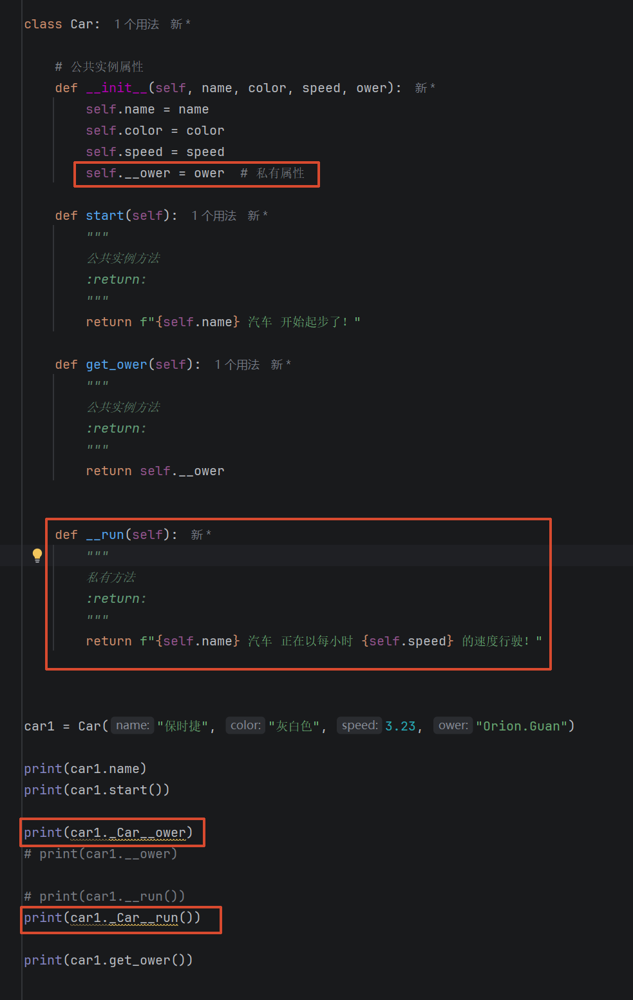
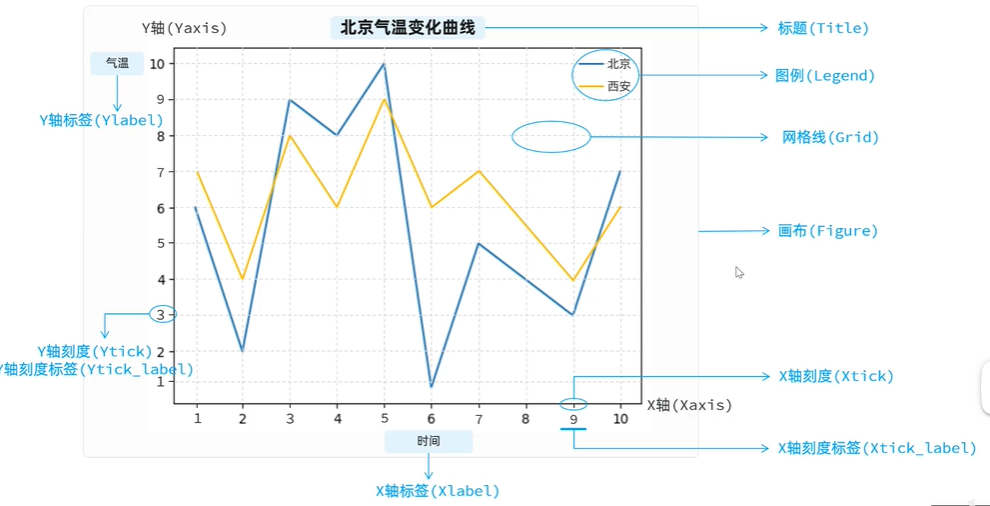
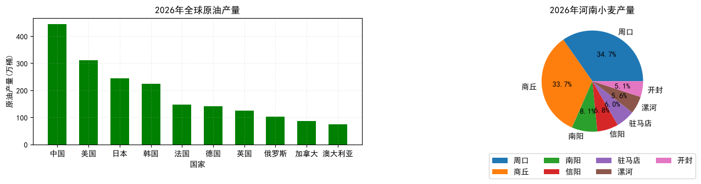

# Python基础速通笔记

## 目录

- [一、基本数据类型](#一基本数据类型)
    - [字符串格式化](#字符串格式化)
    - [1.1 算数运算符](#11-算数运算符)
    - [1.2 比较运算符](#12-比较运算符)
    - [1.3 逻辑运算符](#13-逻辑运算符)
- [二、高级数据类型](#二高级数据类型)
    - [2.1 list 列表](#21-list-列表)
    - [2.2 tuple 元组](#22-tuple-元组)
    - [2.3 set 集合](#23-set-集合)
    - [2.4 dict 字典](#24-dict-字典)
- [三、条件判断](#三条件判断)
- [四、循环语句](#四循环语句)
- [五、函数](#五函数)
    - [5.1 函数定义](#51-函数定义)
    - [5.2 传参方式](#52-传参方式)
    - [5.3 全局变量与局部变量](#53-全局变量与局部变量)
    - [5.4 函数递归调用](#54-函数递归调用)
    - [5.5 lambda 表达式](#55-lambda-表达式)
- [六、异常处理](#六异常处理)
- [七、模块与包](#七模块与包)
    - [7.1 模块](#71-模块)
    - [7.2 包](#72-包)
    - [7.3 第三方包管理](#73-第三方包管理)
- [八、类与对象](#八类与对象)
    - [8.1 封装](#81-封装)
        - [8.1.1 私有属性和私有方法](#811-私有属性和私有方法)
    - [8.2 继承](#82-继承)
        - [8.2.1 单继承](#821-单继承)
        - [8.2.2 多继承](#822-多继承)
        - [8.2.3 抽象类与抽象方法](#823-抽象类与抽象方法)
    - [8.3 多态](#83-多态)
- [九、文件操作](#九文件操作)
    - [9.1 操作普通文件](#91-操作普通文件)
    - [9.2 操作 JSON 串](#92-操作-json-串)
    - [9.3 操作 CSV 文件](#93-操作-csv-文件)
- [十、正则表达式](#十正则表达式)
    - [10.1 常用方法](#101-常用方法)
    - [10.2 模式规则](#102-模式规则)
    - [10.3 匹配次数](#103-匹配次数)
- [十一、网络爬虫](#十一网络爬虫)
    - [11.1 爬虫执行流程](#111-爬虫执行流程)
    - [11.2 Xpath语法](#112-xpath语法)
- [十二、数据分析](#十二数据分析)
    - [12.1 Pandas数据处理工具](#121-pandas数据处理工具)
        - [12.1.1 DataFrame与Series两大对象](#1211-dataframe与series两大对象)
        - [12.1.2 数据读写](#1212-数据读写)
        - [12.1.3 数据查看&选择&过滤](#1213-数据查看选择过滤)
        - [12.1.4 数据清洗](#1214-数据清洗)
        - [12.1.5 数据排序](#1215-数据排序)
        - [12.1.6 数据分组](#1216-数据分组)
    - [12.2 Matplotlib数据可视化图表工具](#122-matplotlib数据可视化图表工具)
        - [12.2.1 折线图](#1221-折线图)
        - [12.2.2 柱状图与饼图](#1222-柱状图与饼图)
- [十三、Web应用（FastAPI框架）](#十三web应用fastapi框架)
    - [13.1 FastAPI框架](#131-fastapi框架)
    - [13.2 使用步骤](#132-使用步骤)
    - [13.3 QA问答环节](#133-qa问答环节)
- [十四、AI应用](#十四ai应用)
    - [14.1 大模型部署](#141-大模型部署)
    - [14.2 大模型调用](#142-大模型调用)
        - [14.2.1 AI API接口调用](#1421-ai-api接口调用)
        - [14.2.2 会话记忆方案](#1422-会话记忆方案)
    - [14.3 Prompt提示词工程](#143-prompt提示词工程)
    - [14.4 Streamlit框架](#144-streamlit框架)
    - [14.5 AI聊天伴侣项目](#145-ai聊天伴侣项目)

---

## 一、基本数据类型

- `int` - 整数类型
- `float` - 浮点数类型
- `str` - 字符串类型
- `bool` - 布尔类型
- `NoneType` - 空类型

### 字符串格式化

```python
f'字符串文本{变量}'  # 模板字符串格式化
r'撸起袖子\n加油干'  # r 去除转义字符（\n）特殊含义，原样输出
```

### 1.1 算数运算符

```python
a // b  # 整除
a ** n  # a 的 n 次方
```

### 1.2 比较运算符

支持数学形式的比较，例如：`>`、`<`、`>=`、`<=`、`==`、`!=`

### 1.3 逻辑运算符

| 运算符 | 说明   | 特点                       |
|--------|--------|----------------------------|
| `and`  | 逻辑与 | 全真即真，有假即假（短路） |
| `or`   | 逻辑或 | 有真即真，全假为假（短路） |
| `not`  | 逻辑非 | 取反                       |

---

## 二、高级数据类型

### 2.1 list 列表

```python
list1 = [1, 2.4, True, 'Hello', 1]
```

**特点**：有序、可重复、可修改

**列表推导式**：

```python
[item for item in range(10) if item > 3]
```

**解包 & 组包**：

```python
list2 = [*list]
```

---

### 2.2 tuple 元组

```python
tuple1 = (1, 2.1, 1, 'str', False)
```

**特点**：有序、可重复、不能修改

**解包**：

```python
a, *b, c = (1, 2, 4, 5, 6)  # a=1, c=6, b=[2, 4, 5]
```

---

### 2.3 set 集合

```python
set1 = {1, 2, 'str', True}
```

**特点**：无序且唯一，不支持切片和索引访问

**集合推导式**：

```python
{item for item in range(10) if item > 5}
```

---

### 2.4 dict 字典

```python
dict1 = {key: value, key: value}
```

**特点**：

- 键必须是不可变类型
- 值可以任意类型
- 键若已存在则修改会覆盖原值

**字典推导式**：

```python
{key: key * 2 for key in range(10) if key < 8}
```

---

## 三、条件判断

### if-elif-else 结构

```python
if 逻辑表达式:
    代码块
elif 逻辑表达式:
    代码块
elif 逻辑表达式:
    代码块
else:
    代码块
```

### match-case 结构（Python 3.10+）

```python
match 变量:
    case 常量:
        代码块
    case 常量 | 常量:
        代码块
    case 常量 if 条件:
        代码块
    case _:
        其他默认情况代码块
```

---

## 四、循环语句

### for 循环

```python
for item in range(1, 10, 1):
    循环体
else:
    正常迭代完毕执行代码块（遇到
    break
    则不执行）
```

### while 循环

```python
while 逻辑表达式:
    循环体
else:
    正常迭代结束执行的代码块（遇到
    break
    则不执行）
```

### 循环控制关键字

| 关键字     | 说明                             |
|------------|----------------------------------|
| `break`    | 退出本层循环                     |
| `continue` | 结束本层的本轮循环，开始下轮循环 |

---

## 五、函数

### 5.1 函数定义

```python
def func(形参1, 形参2=默认值, *args, **kwargs):
    函数体
    return
```

**参数说明**：

- `*args` - 收集多个位置参数到元组
- `**kwargs` - 收集多个关键字参数到字典

### 5.2 传参方式

| 方式       | 说明                             |
|------------|----------------------------------|
| 位置传参   | 一一对应，类似 Java              |
| 关键字传参 | `func(key1=value1, key2=value2)` |

### 5.3 全局变量与局部变量

```python
global 变量名  # 在函数内声明为函数外的全局变量赋值
```

### 5.4 函数递归调用

- 递推 → 递归，必须有结束返回条件

### 5.5 lambda 表达式

```python
# 定义（自动返回表达式计算的结果）
func_address = lambda 形参1, 形参2: 表达式

# 调用
func_address(实参1, 实参2)
```

---

## 六、异常处理

> 默认方法报错后，异常信息会沿着调用链逐层向源头返回，并导致程序运行终止。一旦异常被捕获，则异常信息不会再向源头返回，也不会阻止程序正常执行。

```python
try:
    代码块
except Exception as error:
    处理异常代码块（try 中的代码块抛出异常后执行此方法）
    raise FileNotFoundError("会话不存在")  # 抛出文件未找到异常
finally:
    释放资源代码块（不管
    try 中是否抛出异常都会执行）
```

---

## 七、模块与包

### 7.1 模块

> 一个 `xxx.py` 文件就是一个模块，模块中可以是变量、函数、类与对象。

```python
from 模块 import *  # 导入模块
```

### 7.2 包

> 如果一个目录下包含 `__init__.py` 文件，则此目录就是软件包，该文件中定义包的元信息。

**内建变量**：

| 变量名     | 说明                                                                        |
|------------|-----------------------------------------------------------------------------|
| `__name__` | 在当前模块执行表示 `"__main__"`，作为其他模块导入执行时表示模块文件名字符串 |
| `__all__`  | 定义软件包或者模块中对外导入该模块或包时，暴露给 `*` 通配符的成员有哪些     |

### 7.3 第三方包管理

```bash
pip install 软件包名  # 下载第三方软件包
```

---

## 八、类与对象

```python
class ClassName:
    # 类属性
    father_name = "Orion"
    father_age = 62
    father_gender = '男'

    # 魔术方法。定义实例属性（类似 Java 类中的构造器，创建对象时自动调用）
    def __init__(self, name, age, gender):
        self.name = name
        self.age = age
        self.gender = gender

    # 定义实例方法（self 表示类创建的每个实例对象，调用时不用赋值）
    def func(self, 参数):
        方法体
```

**说明**：以 `__函数名__()` 命名的方法都是魔术方法，魔术方法会在程序执行的特定时期自动调用。

类的使用:

```python
personObj = ClassName('小关', 26, '男')  # 创建对象

personObj.name  # 访问实例属性
ClassName.father_name  # 访问类属性
personObj.func(实参)  # 调用实例方法
```

### 8.1 封装

封装就是将数据（成员属性）和 操作数据的方法（成员方法）放一起构成一个整体，这个整体就是一个类。

#### 8.1.1 私有属性 和 私有方法

- __属性名: 私有属性
- __方法名: 私有方法

特点:
1、私有属性和私有方法只能在类的内部供类中的其他方法调用，不能在类的外部通过类的对象访问（在类内部使用）。
2、如果想在类的外部访问这些私有属性和方法，一般是通过在类中定义公共方法来实现间接访问，如：get、set方法

注意:
Python是没有类似Java那样真正的私有机制，这些私有属性和方法之所以无法直接在类的外部访问，是因为Python内部通过改写私有属性和私有方法的名称来实现的，即在私有成员的名称前隐式添加了”_
类名“。


### 8.2 继承

继承主要是为了解决在创建类时，对于多个类都需要的成员属性和方法，如果都写在每个类中，就会导致代码重复，不利于维护。为了解决成员属性和方法重复在每个类中编写，
我们就可以把这些每个类在创建时都需要的公共属性和方法抽取到一个父类中，然后让子类继承父类，这样子类就会拥有父类的成员属性和方法，而不用每个子类都编写相同的代码.

#### 8.2.1 单继承

```python
class 子类名(父类名):
    pass
```

说明:

- 定义的类如果没有显式使用括号指定要继承的父类，则默认继承自object类，即所有类都是object类的子类。

- 子类只能继承父类中所有公有的成员属性和方法，无法继承父类中的私有属性和方法。

##### 方法重写

如果子类继承父类中的某个公共方法无法满足特定需求，子类可以在其内部重新定义该方法，即方法重写。
这样，子类对象调用该方法时，将执行子类中重写后的方法，而不是父类中的方法。

> 说明: 如果子类重写父类的方法体中想调用父类中被重写的同名方法，有如下两种方式
> 1. 使用 "super ().父类方法名 ()" 方式调用
> 2. 使用 "父类名.方法名 (self)" 方式调用

注意: 子类重写父类方法时，方法名和参数列表必须与父类中的方法完全一致。

#### 8.2.2 多继承

多继承是指一个子类可以继承多个父类（Java中是单继承），从而拥有所有父类中的非私有的成员属性和方法。

```python
class 子类名(父类名1, 父类名2, 父类名3):
    def __init__(self):
        super().__init__()  # 调用父类1的__init__方法
        父类名2.__init__(self)  # 调用父类2的__init__方法
        父类名3.__init__(self)  # 调用父类3的__init__方法
        self.fly = True  # 新增一个子类自己的实例属性fly

    pass
```

#### 8.2.3 抽象类与抽象方法

在Python中继承了ABC抽象基类的类被称为抽象类。抽象类中可以定义抽象方法（abstractmethod装饰器装饰：必须在子类中重写），也可以定义非抽象方法。
抽象不能直接创建实例对象，只能作为父类、定义一些规范接口（抽象方法），让子类实现。

装饰器: 用于在不改变原函数功能的情况下，添加额外的功能。类似Java中的"AOP+注解"对方法只做增强不做修改。
> 装饰器感觉就是偷梁换柱，看着调用的还是原函数，其实际上原函数名指向的地址已经变成了装饰器内部定义的函数了，只是明面上看着还是原函数。所以调用时其实调用的是装饰器内部的函数。

```python
from abc import ABC, abstractmethod


class 类名(ABC):
    @abstractmethod  # 抽象方法装饰器: 必须在子类中重写
    def 方法名(self):
        pass
```

##### MRO方法解析顺序

背景: 在多继承中，子类待调用的方法在自身以及多个父类中都有，优先使用哪个类中的方法？Python会遵循MRO原则。可以通过"类名.mro
() | 类名. __mro__"方法查看。<br>
顺序:
1、子类自己的方法 2、父类1的方法（不会向上找父类1的父类的方法） 3、父类2的方法 4、父类3的方法 5、object类的方法

### 8.3 多态

调用同一个函数，传递的参数对象不同，函数的执行结果也不同（Java中的多态依赖继承+重写，而Python中的多态不依赖继承，只要不同类的对象有相同方法即可（鸭子类型-->
类似Java中的泛型）
> 如：定义函数时，参数类型指定为父类类型，在执行的时候传入不同的子类对象，就具有不同的形态

```python
class Car(object):
    def __init__(self, make, model, year):
        self.make = make
        self.model = model
        self.year = year


class ElectricCar(Car):
    def __init__(self, make, model, year):
        super().__init__(make, model, year)


class FuelCar(Car):
    def __init__(self, make, model, year):
        super().__init__(make, model, year)


def info(car: Car):
    print(car.__dict__)  # 打印对象的属性字典


if __name__ == '__main__':
    """
    多态的测试(相同info方法，不同结果)
    """
    info(FuelCar('奔驰', '红色', 120))  # {'make': '奔驰', 'model': '红色', 'year': 120}
    info(ElectricCar('特斯拉', '白色', 120))  # {'make': '特斯拉', 'model': '白色', 'year': 120}
```

## 九、文件操作

### 9.1 操作普通文件

```python
with open("文件路径", "打开模式", encoding="utf-8") as fileObj:
    代码块
```

**使用步骤**：

1. 打开文件：`file = open("文件路径", "打开模式", encoding="utf-8")`
2. 读写操作：
    - `file.read()` - 读取全部内容
    - `file.write("内容")` - 写入全部内容
3. 关闭文件：`file.close()` - 关闭文件，刷新缓冲区并释放资源

### 9.2 操作 JSON 串

```python
import json

# 序列化字典数据到文件
json.dump(dict, file, ensure_ascii=False, indent=2)
# ensure_ascii=False 确保能打开文件能正确解析中文
# indent=2 确保序列化到文件中的 json 串是格式化后的

# 将文件中的 json 数据反序列化到字典变量
data = json.load(file)
```

### 9.3 操作 CSV 文件

```python
import csv

with open('文件路径', '打开方式', encoding='utf-8', newline='') as f:
    # 写入行数据
    writer = csv.DictWriter(f, fieldnames=['姓名', '年龄', '性别'])
    writer.writeheader()  # 写入表头
    writer.writerow({'姓名': '张三', '年龄': 20, '性别': '男'})

    # 读取 csv 文件内容
    reader = csv.DictReader(f)
    for row in reader:
        print(row)
```

---

## 十、正则表达式

```python
import re
```

### 10.1 常用方法

| 方法                           | 说明                     | 返回值               |
|--------------------------------|--------------------------|----------------------|
| `re.match(模式字符串, 文本)`   | 开头匹配                 | Match 对象           |
| `re.search(模式字符串, 文本)`  | 任意位置匹配，只匹配一次 | Match 对象           |
| `re.findall(模式字符串, 文本)` | 全局匹配                 | 所有匹配的字符串列表 |

**Match 对象方法**：

| 方法                      | 说明                                               |
|---------------------------|----------------------------------------------------|
| `obj.group(组号索引下标)` | 获取匹配的字符串                                   |
| `obj.span()`              | 匹配到的字符串在文本中的索引位置（不包含结束索引） |
| `obj.start()`             | 获取开始索引                                       |
| `obj.end()`               | 获取结束索引                                       |

### 10.2 模式规则

| 符号       | 说明                                     |
|------------|------------------------------------------|
| `.`        | 匹配任意单个字符（除\n换行符外）         |
| `[A-Za-z]` | 匹配单个英文字母（大小写）               |
| `[^aeiou]` | 匹配非中括号内的任意单个字符             |
| `\d`       | 匹配单个数字                             |
| `\D`       | 匹配非数字的单个字符                     |
| `\s`       | 匹配单个空白字符（空格、制表符、换行等） |
| `\S`       | 匹配非空格单个字符                       |
| `\w`       | 匹配单个普通字符串（数字、字母、下划线） |
| `\W`       | 匹配单个非普通字符即特殊字符             |
| `普通字符` | 直接匹配普通字符                         |

### 10.3 匹配次数

> 定义前个模式规则字符的匹配次数

| 符号            | 说明                               |
|-----------------|------------------------------------|
| `*`             | 前个字符匹配任意个数               |
| `+`             | 前个字符至少匹配一次               |
| `?`             | 前个字符至多匹配一次               |
| `{n}`           | 前个字符必须匹配 n 次              |
| `{min,}`        | 前个字符至少匹配 min 次            |
| `{min, max}`    | 前个字符匹配 min 到 max 之间个次数 |
| `^字符串`       | 目标文本必须以指定字符串开头       |
| `字符串$`       | 目标文本必须以指定字符串结尾       |
| `str1 \|  str2` | 目标字符串要么是 str1，要么是 str2 |
| ()              | 分组匹配提取值                     |

---


## 十一、网络爬虫

> 描述: 网络爬虫其实就是用编程语言写的一段脚本程序，用来获取网页上的一些资源。

robots协议: 声明网站中哪些资源可以被爬取，通常位于网站根目录。

### 11.1 爬虫执行流程

1、程序执行

2、向目标网站发起http请求（requests）

3、解析网站响应回来的页面元素并提取资源（lxml）

4、对提取到的数据进行清洗处理

5、存储数据

6、结束

### 11.2 Xpath语法

> 描述: 在lxml软件包解析文档内容时，使用Xpath语法能快速定位并获取标签、属性、内容。

```python
/: 从文档根节点查找元素
//: 从文档任意节点位置查找元素
./ 从当前节点元素下查找
meta[4]: 定位到meta标签的第4个元素
meta[last()]: 定位到meta标签的最后一个元素
meta[@name]: 定位到meta标签中含有name属性的元素
meta[@property="og:url"]: 定位到meta标签中含有property属性且属性值为og:url的元素
*: 通配符，匹配任意元素
@*: 通配符，获取标签内的所有属性值
text(): 获取标签内的文本内容
```


## 十二、数据分析

> 以下进入数据分析领域，需要 `pandas` 和 `matplotlib` 两个第三方库，可通过 `pip install pandas matplotlib` 安装。

### 12.1 Pandas数据处理工具

```python
import pandas as pd
```

#### 12.1.1 DataFrame与Series两大对象

- DataFrame对象: 代表表格
- Series对象: 代表表格中的某列

```python
from operator import index

import pandas as pd

# 创建DataFrame对象方式
df1 = pd.DataFrame([
    {"name": "张三", "age": 18},
    {"name": "李四", "age": 19},
    {"name": "王五", "age": 20}
])
df1

df2 = pd.DataFrame({
    "name": ["张三", "李四", "王五"],
    "age": [18, 19, 20]
})
df2

df3 = pd.DataFrame([
    ['张三', 18],
    ['李四', 19],
    ['王五', 20]
], columns=["name", "age"])
df3

df4 = pd.DataFrame([
    ['张三', 18],
    ['李四', 19],
    ['王五', 20]
], columns=["name", "age"], index=['a', 'b', 'c'])  # 创建DataFrame并指定索引
df4

df5 = pd.DataFrame([
    ('张三', 18),
    ('李四', 19),
    ('王五', 20)
], columns=["name", "age"])
df5

# DataFrame常用属性
df5.index.tolist()  # 表格的行索引

df5.columns.tolist()  # 表格表头

df5.values.tolist()  # 表格的值

df5.size  # 获取单元格个数

df5.dtypes  # 获取各列类型

df5.shape  # 获取表格数据维度(3行数, 2列数)

# 创建Series对象方式

s1 = pd.Series([10, 9, 23, 24])
s1

s2 = pd.Series((10, 9, 23, 24), index=['a', 'b', 'c', 'd'])
s2

s3 = pd.Series({'a': 10, 'b': 9, 'c': 23, 'd': 24})
s3

# Series常见属性
s3.index.tolist()  # 获取索引
s3.values.tolist()  # 获取值
s3.size  # 获取元素个数
s3.dtype  # 获取数据类型
s3.shape  # 获取数据包维度(4行,)
```

#### 12.1.2 数据读写

- read_xxx ("文件路径")：读取文件获取DataFrame对象。如: read_csv, read_excel
- to_xxx ("保存到的文件路径")：保存文件到本地目录 如: to_csv, to_excel

#### 12.1.3 数据查看&选择&过滤

##### 12.1.3.1 数据查看

- head (行数) ------查看前几行
- tail (行数) ------查看后几行
- describe () ------查看表格数值列统计信息
- info () ----------查看表结构

##### 12.1.3.2 选择数据

###### 选择列

- df['列名'] --------查看某一列
- df[['列名1','列名2']] --------查看多列

###### 选择行 (行切片)

- df.iloc[start:end:step] -------按行切片，不包含end行 (tip: 表格行号固定从0开始，不同索引列)
- df.loc[start:emd:step] --------按索引列切片，包含end行

##### 12.1.3.3 过滤数据

语法: df[条件表达式]

```python
示例: df[(df['单价'] >= 100) & (df['类别'].isin(['类别1', '类别2', ...]))]  # 筛选出单价大于等于100的数据，且类别是类别1或类别2的数据
```

#### 12.1.4 数据清洗

##### 空值处理

- isnull () -----查看表格是否有空值
- dropna () -----默认删除空值所在行，也可以指定参数删除空值所在列
- fillna ("填充值") -----按指定参数填充空值
- ffill () -------使用空值所在的上行列的值填充空值
- bfill () -------使用空值所在的下行列的值填充空值

##### 重复值处理

- duplicated () -----默认查看整行是否有重复值，也可以参数指定查看某列是否有重复值
- drop_duplicates ()-----默认只保留首行，也可指定参数设置删除规则

##### 异常值处理

- df[筛选条件] ----查看异常数据
- df['列名'].str.replace ('/','-') -----处理替换某列的异常值

#### 12.1.5 数据排序

```python
# 先根据上映时间升序排序，相同的部分在根据评分降序
df.sort_values(["上映时间", "评分"], ascending=[True, False])
```

#### 12.1.6 数据分组

```python
import pandas as pd

df = pd.read_csv('data/movies_info3.csv', nrows=50)

# 求取每个年份的电影时常之和
df.groupby('年份')['时常'].sum()

# 获取每年电影评分的最大值
df.groupby('年份')['评分'].max()

# 获取每年电影评分的最小值
df.groupby('年份')['评分'].min()

# 获取每年电影的数量
df.groupby('年份')['电影名'].count()

# 获取每年电影评分的平均值
df.groupby('年份')['评分'].mean()

# 获取每年电影评分的最大值、最小值、平均值
df.groupby('年份')['评分'].agg(['min', 'max', 'mean'])

# 获取每年电影时常的最大值，电影评分的平均值
df.groupby('年份').agg({'时常': 'max', '评分': 'mean'})
```

---

### 12.2 Matplotlib数据可视化图表工具



#### 12.2.1 折线图

```python
# 导入matplotlib包下的 pyplot 模块，并使用 plt 简写
import matplotlib.pyplot as plt
import random

#目标： 绘制一个折线图

#准备数据
x_axis = [item for item in range(0, 25)]
y_axis = [random.randint(0, 50) for item in range(0, 25)]
y_axis_2 = [random.randint(0, 50) for item in range(0, 25)]

#设置画布宽高
plt.figure(figsize=(10, 4))

#绘制折线
plt.plot(x_axis, y_axis, label="河南")
plt.plot(x_axis, y_axis_2, label="浙江")

#设置标题
plt.title("24小时温度变化")

#分别设置x轴和y轴的标签
plt.rcParams['font.sans-serif'] = ['SimHei']  #设置字体
plt.xlabel("时间")
plt.ylabel("温度")

# 设置x轴与y轴的刻度
plt.xticks(x_axis)
plt.yticks(range(0, 51, 5))

#设置网格线
plt.grid(linestyle='--', alpha=0.5)

#设置图例
plt.legend()
```

#### 12.2.2 柱状图与饼图



```python
from matplotlib.axes import Axes
import matplotlib.pyplot as plt

# 设置中文字体
plt.rcParams['font.sans-serif'] = ['SimHei']

# 创建子图: figure 画布对象，axes数组子图对象
figure, axes = plt.subplots(nrows=1, ncols=2, figsize=(17, 3))  # 创建1行2列的子图，图形大小为10x5

#准备数据
countries = ['中国', '美国', '日本', '韩国', '法国', '德国', '英国', '俄罗斯', '加拿大', '澳大利亚']
oil_production = [445.3, 310.9, 244.6, 223.4, 147.6, 141.6, 124.1, 102.6, 85.7, 74.8]

#获取第一个子图对象
axes1: Axes = axes[0]

#绘制柱状图
axes1.bar(countries, oil_production, color='green', width=0.6)

#设置x轴和y轴标签
axes1.set_xlabel('国家')
axes1.set_ylabel('原油产量(万桶)')

#设置网格线
axes1.grid(linestyle='--', alpha=0.2)

#设置标题
axes1.set_title('2026年全球原油产量')

#操作第二个子图
axes2: Axes = axes[1]

#准备数据
wheat_yield = [14.51, 14.09, 3.4, 2.83, 2.51, 2.33, 2.12]
region = ['周口', '商丘', '南阳', '信阳', '驻马店', '漯河', '开封']

#绘制饼图。设置autopct参数，显示每个扇区的百分比
axes2.pie(wheat_yield, labels=region, autopct='%1.1f%%')

#设置标题
axes2.set_title('2026年河南小麦产量')

#设置图例. loc: 图例位置，ncol: 图例列数，bbox_to_anchor: 图例位置偏移量(0.5控制水平位置，-0.3控制垂直位置为下移)
plt.legend(loc='lower center', ncol=4, bbox_to_anchor=(0.5, -0.3))

#保存图片
plt.savefig('../data/2026年河南小麦产量.png')

#显示图形
plt.show()
```

## 十三、Web应用（FastAPI框架）

### 13.1 FastAPI框架

fastapi是为python编程语言提供构建web应用API接口的Web框架，类似于Java中的SpringMVC框架。

### 13.2 使用步骤

1. 安装软件包
    ```python
    pip install fastapi
    ```

2. 创建fastapi应用实例
   ```python
   from fastapi import FastAPI
   app = FastAPI()
   ```

3. 定义路由函数

   ```python
   @app.get("/")
   def read_root():
       return {"Hello": "World"}
   ```

4. 运行fastapi应用

   - 代码中运行(推荐)
    ```python
    if __name__ == "__main__":
        import uvicorn # uvicorn 是fastapi的默认服务器，用于运行fastapi应用
        uvicorn.run(app, host="0.0.0.0", port=80)
    ```
   - 命令行中运行
    ```python
    fastapi dev "xxxx.py"
    uvicorn xxxx:app --reload
    ```

### 13.3 QA问答环节

```python
3.1 接口如何直接返回后端文件给前端?
    from fastapi.responses import FileResponse
    # 定义访问首页接口路径
    @app.get("/")
    def get_index():
        return FileResponse("static/index.html")

    
3.2 如何只需要前端访问固定虚拟路径，服务端就可以映射对应的静态资源返回前端？
    from fastapi.staticfiles import StaticFiles
    #挂载静态资源目录(前端访问“/static/**”下的路径，系统将映射到“static”目录下，查找对应资源)
    app.mount("/static", StaticFiles(directory="static"), name="staticFiles")

    
3.3 fastapi如何接收前端发送的json数据？
    首先需要定义一个实体类并继承BaseModel，里面的类属性需要与前端json请求体中的参数保持一致。
    # 定义会话上下文类
    class SessionContext(BaseModel):
        session_id: str
        message: str

        
3.4 fastapi如何将后端服务的对象数据序列化为json格式返回给前端？
    fastapi会自动将对象序列化为json格式，无需手动处理。

    
3.5 python中使用什么来专门记录日志？
    python中使用logging模块来专门记录日志。

    import logging  # 导入内置的logging专门用于日志记录的模块
    # 配置日志基本信息
    logging.basicConfig(
        level=logging.INFO,  # 配置控制台只打印代码中的INFO级别及以上的日志
        format="%(asctime)s - %(levelname)s - %(filename)s:%(lineno)d - %(message)s",  # 日志格式: 时间 - 日志级别(warning、info、debug、error、fatal--->从低到高) - 文件名:行号 - 消息
    )

    
3.6 fastapi如何捕获所有接口的异常信息并返回给前端页面？
    可以使用 "全局异常处理器" 来捕获所有接口的异常信息并返回给前端页面。
    @app.exception_handler(Exception)
    def exception_handler(request: Request, exc: Exception):
        logging.error(f"异常请求: {request.url}, 异常信息: {exc}")
        return JSONResponse(content={"code": 500, "message": f"{exc}", "data": None})  # 必须返回JSONResponse对象
```

## 十四、AI应用

### 14.1 大模型部署

- 本地部署：Ollama部署工具（Ollama是部署开源大模型到本地电脑并运行和管理大模型的工具。）

  1、官网下载地址: https://ollama.com/download/OllamaSetup.exe

  2、自定义安装路径（默认双击安装在C盘）

  > １、在安装包所在目录打CMD,并执行: OllamaSetup.exe /DIR="D:\Program Files\Ollama"
  >
  > 2、设置Ollama拉取下载的大模型路径
  >
  > 
  >
  > 3、从 Ollama 官方镜像仓库下载大模型到本地: ollama pull deepseek-r1:14b
  >
  > 4、运行大模型（如果本地未拉取则会先从官网拉取大模型在运行）：ollama run deepseek-r1:14b
  >
  > 5、退出终端交互界面: /bye
  >
  > 6、查看本地已下载的大模型: ollama list 
  >
  > 7、查看正在运行的大模型：ollama ps
  >
  > 8、停止大模型运行：ollama stop
  >
  > 9、卸载大模型：ollama rm

- 官方开发API接口 & 云服务提供平台

### 14.2 大模型调用

#### 14.2.1 AI API接口调用

> 调大模型的API请求体发送的消息类型： 系统提示词（给AI设定的角色和行为准则）+  用户提示词（用户实际提出的问题或指令）

#### 14.2.2 会话记忆方案

> 背景： 由于调用大模型的API接口是基于http无状态协议的，因此每次向大模型提问调其接口，大模型是不知道之前与用户的交互的信息背景的。这样就导致用户在基于之前会话信息向大模型发送提问调接口时，大模型不知道用户具体问的是啥。

解决方法：每次向大模型提问调接口时，在消息体中都累加携带之前与大模型交互发起的提问以及大模型上次回复的消息即会话上下文信息，这样在每次调大模型的接口时，他就能基于用户之前的提问等上下文信息给出回答（滚雪球方案）。


### 14.3 Prompt提示词工程

> 提示词模板： 角色 + 任务 + 规则约束边界

角色能力： 给大模型设定角色与能力

任务需求： 明确核心请求与任务，按步骤拆解复杂任务

约束条件： 指定输出风格与语气，明确要求输出格式，提供输入输出的示例


### 14.4 Streamlit框架

> Streamlit是一个开源的 Python 框架，专为数据科学家和 AI/ML 工程师设计，只需几行代码即可构建动态Web数据应用(有点了类似前端中的element-plus框架)。
>
> 基础用法: API参考文档。https://docs.streamlit.io/develop/api-reference

使用步骤：

1、安装streamlit包并导入到python文件中

2、使用其提供的API方法编写前端页面

3、streamlit run xxx.py 构建并运行web页面

### 14.5 AI聊天伴侣项目

- 消息覆盖问题：用户在streamlit消息输入框输入消息后，消息框历史对话信息被覆盖问题？

原因: 用户每次在streamlit输入框键入消息并发送后，streamlit就会重新执行xxx.py文件重新渲染数据，因此导致历史的对话消息被覆盖。

解决方案：使用streamlit的session_state来缓存历史数据。用户每次对话及AI大模型回复的消息都缓存到此变量中，xxx.py文件每次重新执行时都事先遍历读取里面缓存的历史对话消息并渲染到消息框中就可以了。

- 会话记忆问题：在与大模型的交互中，大模型不知道之前交互的上下文消息？

  原因：大模型的API调用使用的是http无状态协议，因此不具备会话记忆功能。

  解决方案：每次在调大模型API接口发消息时都将历史的对话消息一起打包发给LLM。

- 如何流式输出LLM回复的消息？

  1、在调LLM的接口时，设置stream=True，开启流式输出

  2、循环遍历响应体中的每个词元消息对象，拼接消息并输出到消息框

- 会话管理。如何保存并加载历史会话？

  1、用户侧边栏点击新建会话时，将当前会话历史上下文、系统提示词（昵称、性格）、会话时间戳等以JSON格式保存到系统文件中永久存储

  2、用户侧边栏点击历史会话时，从系统文件中读取加载历史会话消息


